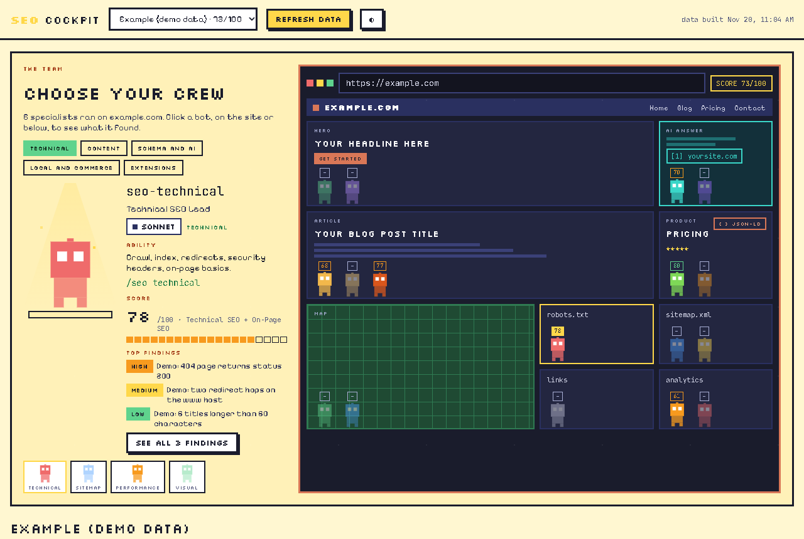

# SEO Cockpit

A local dashboard for SEO audits. You audit a website with an AI coding agent, and the cockpit
shows the result in your browser: a health score, a score per category, every finding with its
fix, an action plan, Core Web Vitals and Search Console numbers.

Everything runs on your own computer. No account, no hosting, no paid API.



## What is in this repository

| File | What it does |
|---|---|
| `cockpit.py` | Collects audits into `data/` and serves the dashboard at http://localhost:8791 |
| `index.html`, `assets/` | The dashboard itself (one page, no build step) |
| `aggregate.py` | Merges the specialists' findings into one audit file and two reports |
| `docs/AUDIT-PROMPT.md` | The prompt you paste into your AI agent to audit a site |
| `audits/example.com-audit/` | A small **fictional** audit so the dashboard is not empty on day one |
| `data/sites.example.json` | Settings template: your sites, optional Google API key |
| `AGENTS.md`, `.kiro/steering/` | Setup and usage instructions written for an AI agent |

## Quick start (about 5 minutes)

You need **Python 3.10 or newer** and **git**. Nothing else for the dashboard itself.

```bash
git clone https://github.com/Virutandel/seo-cockpit-kit.git
```

```bash
cd seo-cockpit-kit
```

```bash
cp data/sites.example.json data/sites.json
```

```bash
python3 cockpit.py serve --port 8791 --no-vitals --no-gsc
```

Open http://localhost:8791. You should see one site, "Example (demo data)", with a score of 73.
That proves the cockpit works. On Windows use `python` instead of `python3` and `copy` instead of `cp`.

**Using an AI agent (Kiro, Claude Code, Cursor)?** Open this folder in it and say:
"Read AGENTS.md and set this project up for me." It will do the steps above and the ones below.

## To audit real sites: install claude-seo

The audits are produced by **claude-seo**, a free, MIT-licensed set of SEO skills and scripts by
AgriciDaniel. The cockpit only displays what it writes.

1. Follow the install instructions at https://github.com/AgriciDaniel/claude-seo
2. When it is installed, this file must exist: `~/.claude/skills/seo/scripts/claude-seo`
   (on Windows: `%USERPROFILE%\.claude\skills\seo\scripts\claude-seo`). If you installed it somewhere
   else, set the environment variable `CLAUDE_SEO_HOME` to the folder that contains `scripts/`.

claude-seo was written for Claude Code, where its skills load automatically. In **Kiro** or another
agent there is no automatic loading, and that is fine: the audit prompt tells the agent which skill
files to read, and the scripts are ordinary Python that any agent can run. Expect a little more
hand-holding than in Claude Code, and if the agent cannot run several helpers at once it will do the
twelve analyses one after another, which is slower (30 to 60 minutes instead of 10 to 20).

## Audit a site

1. Add the site to `data/sites.json`:
   ```json
   { "url": "https://yoursite.com", "label": "Your Site", "gsc": "" }
   ```
2. Open `docs/AUDIT-PROMPT.md`, replace `SITE_URL` with the address, and paste the part below the
   line into your AI agent with this folder open.
3. When it finishes, press **Refresh data** in the dashboard (or restart `cockpit.py serve`).

The audit lands in `audits/yoursite.com-audit/`. That folder is ignored by git, so client data
never leaves your computer by accident.

When you no longer want the demo, delete `audits/example.com-audit` and remove the example entry
from `data/sites.json`.

## Optional: Core Web Vitals and Search Console

Both are free and both can be skipped (that is what `--no-vitals --no-gsc` does).

- **Core Web Vitals:** create a Google API key with the *PageSpeed Insights API* and *Chrome UX
  Report API* enabled, then either put it in `"google_api_key"` in `data/sites.json` or start the
  server with `GOOGLE_API_KEY=your-key python3 cockpit.py serve`. Never commit the key;
  `data/sites.json` is ignored by git for that reason.
- **Search Console:** give claude-seo access to your Google account (its README explains how), then
  set `"gsc": "sc-domain:yoursite.com"` on the site in `data/sites.json`.

Then run without the two `--no-` flags:

```bash
python3 cockpit.py serve --port 8791
```

## Commands

```bash
python3 cockpit.py build
```
Collects everything into `data/` without starting the server. Add `--refresh` to refetch vitals and
Search Console even if they were fetched in the last six hours.

```bash
python3 aggregate.py audits/yoursite.com-audit
```
Rebuilds one audit's `audit-data.json`, `FULL-AUDIT-REPORT.md` and `ACTION-PLAN.md` from its
`findings/*.md` files.

## How the pieces fit

```
your AI agent + claude-seo  ->  audits/<site>-audit/findings/*.md
aggregate.py                ->  audits/<site>-audit/audit-data.json + two reports
cockpit.py build            ->  data/<site>/*.json + data/index.json
index.html                  ->  reads data/ and draws the dashboard
```

Each findings file ends with one JSON block. The category names in it must match the list in
`docs/AUDIT-PROMPT.md` exactly, because the dashboard and the health score match on them.

## Troubleshooting

- **Port already in use:** pick another, for example `--port 8800`.
- **"claude-seo is not installed" in the vitals or Search Console panels:** see the install section;
  the dashboard and the audit pages still work without it.
- **A site shows "No audit yet":** the folder must be named `<domain>-audit` with no `www`, and it
  must contain `audit-data.json`. Run `aggregate.py` on it.
- **"no JSON block" from aggregate.py:** that findings file does not end with a valid fenced JSON
  block. Fix the file and run it again.

## Credits and licence

MIT, see `LICENSE`. The pixel artwork in `assets/` comes from the claude-seo project and is used
under its MIT licence (`assets/LICENSE-claude-seo-artwork.txt`). The fonts (Silkscreen, Pixelify Sans,
JetBrains Mono) load from Google Fonts under the SIL Open Font License. SEO Cockpit is an independent
dashboard and is not part of, or endorsed by, claude-seo, Anthropic or Amazon.
